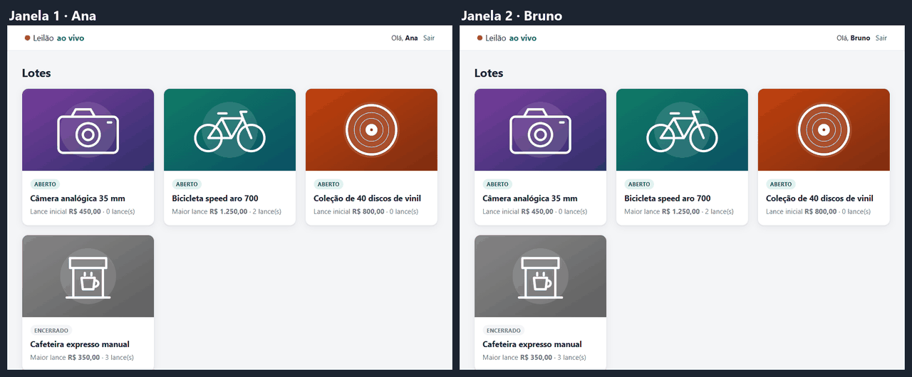

# Leilão ao vivo · PHP + WebSocket

[](https://github.com/wandercosta/leilao-websocket/actions/workflows/testes.yml)

Sala de leilão em tempo real: cada lance é validado no servidor e aparece na hora para todos os navegadores conectados.

**Demo online:** <https://leilao.auradevcode.com.br> · entre com `ana@exemplo.com` / `demo1234` e, numa janela anônima, com `bruno@exemplo.com` / `demo1234`. O banco é recriado todo dia às 4h.



> Projeto criado em 2023 e modernizado em 2026.

## Por que fiz

Em 2023 eu queria entender WebSocket na prática, fora do ciclo requisição/resposta do PHP, e um leilão é um bom caso: várias pessoas disputando o mesmo valor ao mesmo tempo.
Em 2026 voltei ao projeto para fechar o que ficou pela metade: validação no servidor, login de verdade, Docker e testes.

## Funcionalidades

- **Login** com usuários do banco (senha com `password_hash`, sessão regenerada, proteção CSRF).
- **Lista de lotes** com status (aberto/encerrado), maior lance e quantidade de lances.
- **Sala em tempo real**: o lance de um usuário aparece para todos na sala, com histórico, presença ("3 pessoas na sala") e cronômetro.
- **Validações no servidor**, não só no navegador:
  - lance menor que o atual + incremento mínimo é recusado, com o valor mínimo na mensagem;
  - leilão encerrado não aceita lance (e a sala é avisada no momento em que encerra);
  - dois lances simultâneos no mesmo valor: só o primeiro entra (transação com `SELECT … FOR UPDATE`).
- **Conexão WebSocket autenticada** com token assinado (HMAC-SHA256): o servidor não confia no nome ou id que o navegador envia.
- **Reconexão automática** do navegador se o servidor cair.
- **Dados fictícios** carregados na primeira subida: 3 usuários e 4 lotes (um já encerrado, para testar a validação).

## Como rodar

Precisa só do [Docker](https://docs.docker.com/get-docker/).

```bash
git clone https://github.com/wandercosta/leilao-websocket.git && cd leilao-websocket
cp .env.example .env
docker compose up --build
```

Abra <http://localhost:8000> e entre com `ana@exemplo.com` / `demo1234`.
Para ver o tempo real, abra uma janela anônima e entre com `bruno@exemplo.com` / `demo1234` no mesmo lote.

<details>
<summary>Portas ocupadas, testes e outros detalhes</summary>

- Se a porta 8000 ou 8090 já estiver em uso, troque `APP_HTTP_PORT`, `WS_PORT` e `WS_PUBLIC_URL` no `.env`.
- Para recriar o banco do zero (os prazos dos lotes são relativos ao momento da criação): `docker compose down -v`.
- Testes unitários (precisa de PHP 8.2+ e Composer): `composer install && composer test`.

</details>

## Tecnologias

| | |
|---|---|
| Back-end | PHP 8.4, [Ratchet](http://socketo.me/) (WebSocket sobre ReactPHP), PDO |
| Banco | MySQL 8.4 |
| Front-end | HTML, CSS e JavaScript sem framework (WebSocket nativo do navegador) |
| Configuração | [vlucas/phpdotenv](https://github.com/vlucas/phpdotenv) |
| Infra | Docker Compose (Apache + PHP, servidor WebSocket, MySQL) |
| Testes | PHPUnit 11, GitHub Actions |

## Estrutura de pastas

```
.
├── bin/
│   └── servidor-ws.php        # inicia o servidor WebSocket (porta 8090)
├── docker/
│   ├── mysql/                 # schema e dados fictícios, rodam na 1ª subida
│   └── php/Dockerfile         # mesma imagem para o site e para o WebSocket
├── public/                    # raiz do Apache
│   ├── index.php              # rotas: /login, /logout, /, /leilao/{id}
│   ├── css/  img/
│   └── js/sala.js             # cliente WebSocket da sala
├── src/
│   ├── Auth/TokenDeSala.php   # token HMAC que autentica a conexão WebSocket
│   ├── Leilao/
│   │   ├── RegraDeLance.php   # regras do lance (sem banco, testável)
│   │   ├── LeilaoRepositorio.php
│   │   └── Dinheiro.php       # centavos ⇄ "R$ 1.250,00"
│   ├── WebSocket/SalaDeLeilao.php  # salas, broadcast e protocolo JSON
│   ├── Web/View.php
│   ├── Config.php  Database.php
├── templates/                 # páginas em PHP puro
├── tests/                     # PHPUnit
├── docker-compose.yml
└── .env.example
```

## O que aprendi

- **Validar no cliente não é validar.** Na versão de 2023 a regra do lance estava só no JavaScript; qualquer um mandava um lance menor direto pelo socket. Agora a regra fica no servidor e o front só mostra o resultado.
- **O WebSocket não enxerga a sessão do PHP.** São processos separados, então criei um token assinado com HMAC que o site entrega ao navegador e o servidor WebSocket confere.
- **Concorrência existe mesmo com poucos usuários.** Dois cliques no mesmo segundo geram dois lances iguais; a transação com `FOR UPDATE` resolve isso no banco.
- **Dinheiro em centavos.** `float` e vírgula brasileira dão problema; guardar inteiros e formatar só na tela evita isso.
- **Processo PHP de longa duração é diferente.** O servidor WebSocket fica ligado por horas, então ele reconecta no MySQL se a conexão cair, e o `docker compose` espera o banco ficar pronto (healthcheck) antes de subir.
